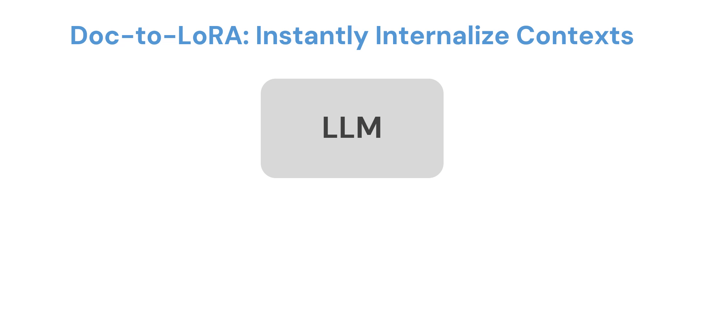

<div align="center">
    <h1>Doc-to-LoRA (D2L): Learning to Instantly Internalize Contexts</h1>
    :newspaper:<a href="https://x.com/SakanaAILabs">X</a> |
    :scroll:<a href="https://arxiv.org/abs/xxxxx">Paper</a> |
    :hugs:<a href="https://huggingface.co/SakanaAI">Hugging Face</a> |
    :octocat:<a href="https://github.com/SakanaAI/doc-to-lora">GitHub</a>
<br>A reference implementation of Doc-to-LoRA (D2L).<br>
</div>
<div align="center">
    
</div>

---

## 🛠️ Installation
```
curl -LsSf https://astral.sh/uv/install.sh | sh
./install.sh
```

## 🤗 Pre-Trained Models
```
uv run huggingface-cli login
uv run huggingface-cli download SakanaAI/doc-to-lora --local-dir . --include "trained_t2l/*"
```

## 🚀 Python API Usage
```python
# caveat: this interface only supports non-batched inputs
# for batched inference please see `src/ctx_to_lora/modeling/hypernet.py`
import torch

from ctx_to_lora.model_loading import get_tokenizer
from ctx_to_lora.modeling.hypernet import ModulatedPretrainedModel

# model loading
checkpoint_path = ...
state_dict = torch.load(checkpoint_path, weights_only=False)
model = ModulatedPretrainedModel.from_state_dict(
    state_dict, train=False, use_sequence_packing=False
)
model.reset()
tokenizer = get_tokenizer(model.base_model.name_or_path)

# prepare data
doc = open("data/sakana_wiki.txt", "r").read()
chat = [{"role": "user", "content": "Summarize what Sakana AI does."}]
chat_ids = tokenizer.apply_chat_template(
    chat,
    add_special_tokens=False,
    return_attention_mask=False,
    add_generation_prompt=True,
    return_tensors="pt",
).to(model.device)


# calls after internalization will be influenced by internalized info
model.internalize(doc)

outputs = model.generate(input_ids=chat_ids, max_new_tokens=256)
print(tokenizer.decode(outputs[0]))


# remove internalized info
model.reset()

outputs = model.generate(input_ids=chat_ids, max_new_tokens=256)
print(tokenizer.decode(outputs[0]))
```

### 🎮 Interactive Demo
```bash
uv run demo/app.py
```
<div align="center">
    <h3>Video Demo</h3>
    <video src="https://raw.githubusercontent.com/SakanaAI/doc-to-lora/refs/heads/main/assets/doc-to-lora-demo.mp4" controls autoplay muted playsinline preload="metadata" width="900"></video>
</div>

### 🧪 Experimental Scripts
To run any of the following scripts, use `uv run $PATH_TO_SCRIPT` from the root of this project.


| Experiment                           | Data prep                             | Training                      | Evaluation                   | Notes                                                                                                                               |
| ------------------------------------ | ------------------------------------- | ----------------------------- | ---------------------------- | ----------------------------------------------------------------------------------------------------------------------------------- |
| [Main experiment](scripts/main_exp/) | `scripts/main_exp/0-download_data.sh` | `scripts/main_exp/1-train.sh` | `scripts/main_exp/eval/*.sh` | Downloading data is fastest; regenerate only if you need fresh synthetic data. Evaluation scripts reproduce the main paper metrics. |
| [NIAH](scripts/niah/)                | `scripts/niah/0-gen_data.sh`          | `scripts/niah/1-train.sh`     | `scripts/niah/2-eval.sh`     | Run the scripts in order; data generation only needs to happen once                                                                 |


### 🔬 Self-Generated Data Viewer
After downloading/generating the data, we can see samples of the data using this script.
```bash
uv run webui/self_gen_viewer.py
```
See more info at [webui/SELF_GEN_VIEWER.md](webui/SELF_GEN_VIEWER.md).

### 📚 Citation
```bibtex
@techreport{sakana2025doc-to-lora,
  title       = {{Doc-to-LoRA: Learning to Instantly Internalize Contexts}},
  author      = {Rujikorn Charakorn and Edoardo Cetin and Shinnosuke Uesaka and Robert Tjarko Lange},
  institution = {Sakana AI},
  year        = {2026},
  month       = {Febuary},
  note        = {Technical Report}
}
```
